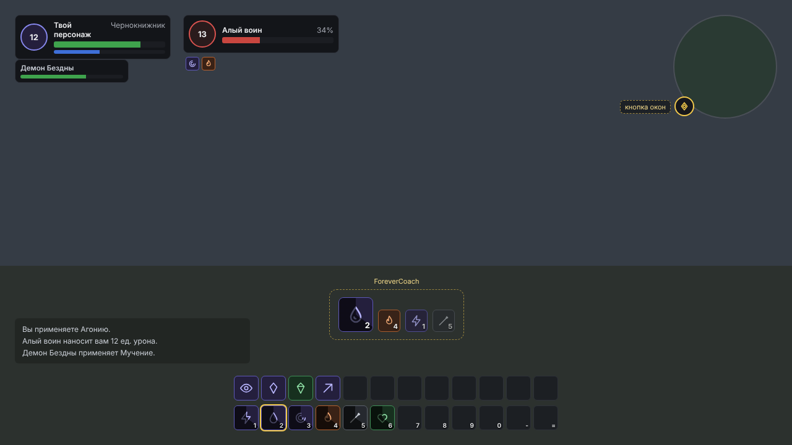
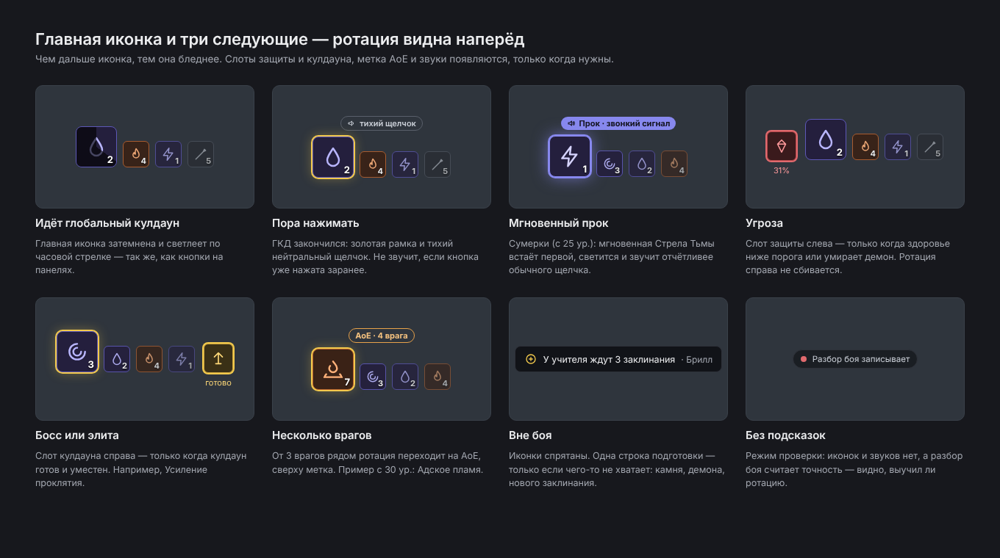
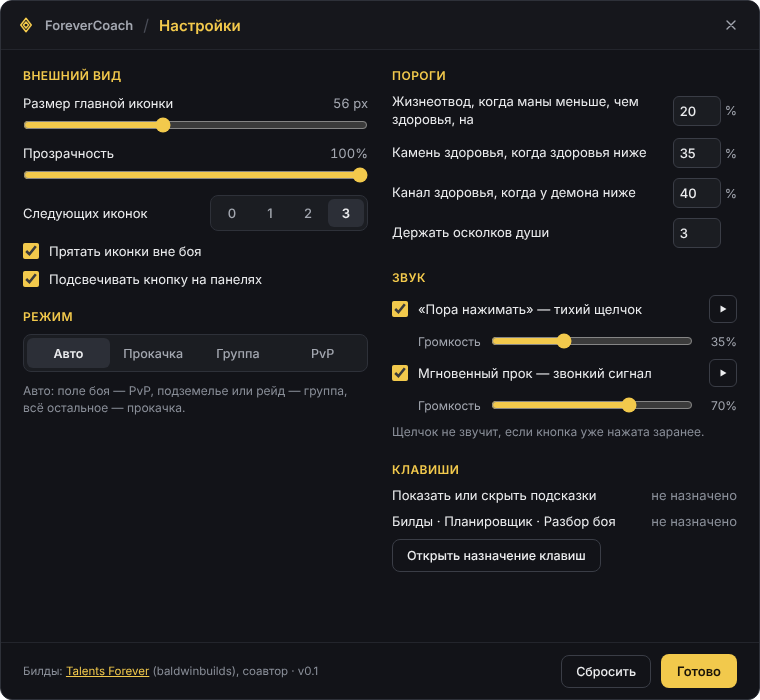
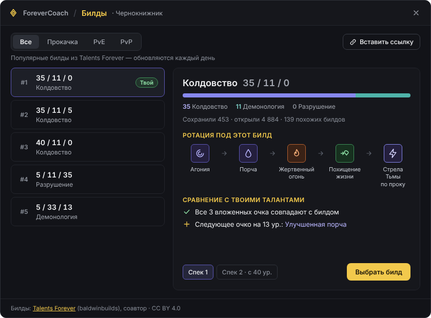
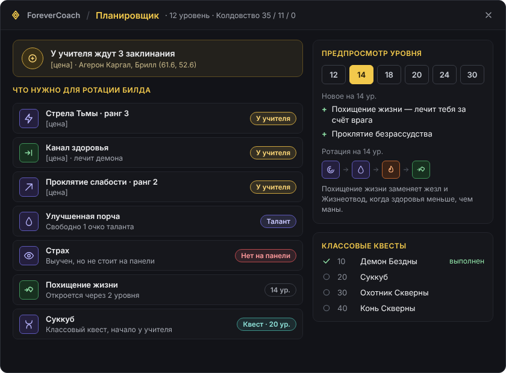
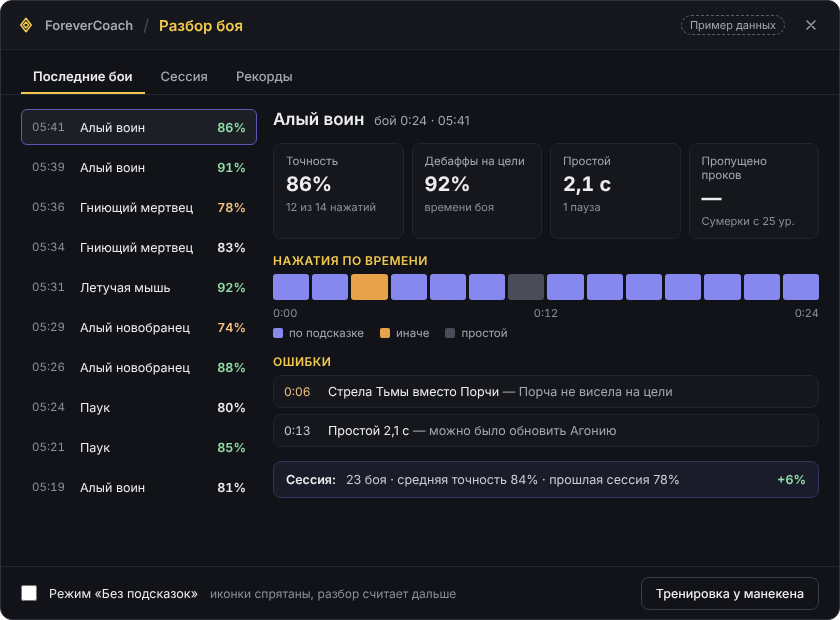

# Интерфейс и макеты

Макеты прислал заказчик вместе с обновлённым ТЗ (холст «ForeverCoach — макеты интерфейса»). Иконки на макетах — заглушки, в игре только настоящие иконки из клиента по ID заклинания (`C_Spell.GetSpellTexture`). Ниже — что сделано и на каком этапе появится остальное.

Палитра макетов, перенесена в `UI/Widgets.lua`: фон окна `#16171C`, панели `#1B1D22`, рамки `#3A3D46`, текст `#ECEDEF`, приглушённый `#A3A7B0`, акцент `#F2C94C`, угроза `#E06A6E`, прок `#8788EE`, AoE `#E8A24A`.

## Экран в бою — сделано (этап 1)

Блок подсказок над панелями, подсвеченная кнопка на панели (настройка «Подсвечивать кнопку на панелях», включена по умолчанию), кнопка у мини-карты.

## Блок подсказок: состояния — сделано (этап 1, кроме «Без подсказок»)

| Состояние | Как в игре | Где |
|---|---|---|
| Идёт ГКД | Главная иконка затемнена и светлеет по часовой стрелке: `CooldownFrameTemplate` с откатом самого заклинания, как у его кнопки на панели. Если клиент откат не отдаёт — свой таймер ГКД | `UI/HUD.lua` |
| Пора нажимать | Золотая рамка и тихий щелчок. Щелчок молчит, если кнопка уже нажата заранее (`UNIT_SPELLCAST_SENT` во время ожидания) | `UI/HUD.lua`, `UI/Sounds.lua` |
| Мгновенный прок | Прок встаёт первым, фиолетовая рамка с пульсирующим свечением, звонкий сигнал | профиль: `glow = true` |
| Мало маны | Под блоком строка «Мало маны — Жизнеотвод» с иконкой: проявляется с 30% маны, полная на 15%. Главная иконка остаётся на виду (просьба игрока: бледный Жизнеотвод поверх неё закрывал подсказку). Когда маны не хватает на следующее заклинание, Жизнеотвод и так становится главной подсказкой | `gate` с `power = "mana"`, `alert` |
| Добивание | Под блоком строка «Цель почти мертва — Похищение души»: проявляется с 35% здоровья цели. С 20% Похищение души целиком занимает главную иконку, с золотой рамкой, без бледной стадии. Видимость решает клиент | `gate` с `warn` и `takeover`, `alert` |
| Угроза | Слот защиты слева с красной рамкой. В Forever здоровье скрыто: Камень здоровья лежит на слоте заранее, а показывает его сам клиент, когда здоровье падает ниже порога («ворота», `gate`). Процент под слотом — только если здоровье видно | ряд `defense` |
| Босс или элита | Слот кулдауна справа с подписью «готово» | ряд `cooldown` |
| Несколько врагов | Метка «AoE: 4 врага» над блоком, от 3 врагов ротация переходит на AoE (Адское пламя с 30, раньше Огненный ливень) | `aoe = true` в профиле |
| Вне боя | Иконки спрятаны (по умолчанию), одна строка подготовки, у учителя — город последнего посещённого учителя класса | ряд `prep` |
| Без подсказок | Блока, звуков и подсветки кнопки нет, разбор боя считает дальше (`/fc nohints` или галочка в окне разбора) | этап 3 |

Размеры как на макете при размере главной иконки 56 px: следующие 36 px (прозрачность 0,9 / 0,72 / 0,55), слоты 40 px, промежутки 8 и 12 px. Всё масштабируется от размера главной иконки.

## Окно «Настройки» — сделано (этап 1)

Всё как на макете: размер главной иконки, прозрачность, следующих иконок 0–3, прятать вне боя, подсветка кнопки, режим, три порога, два звука с громкостью и прослушиванием, клавиши и кнопка «Открыть назначение клавиш», соавтор Talents Forever в подвале. Порог «Жизнеотвод, когда маны меньше, чем здоровья, на N%» с макета убран: в Forever мана и здоровье скрыты всегда, такое сравнение аддону недоступно. Жизнеотвод подсказывается, когда на следующее заклинание не хватает маны (это игра сообщает). Чего на макете нет, осталось командами: `/fc unlock` (двигать блок), `/fc minimap`, `/fc debug`.

Громкость: `PlaySoundFile` громкость не принимает, поэтому каждый сигнал лежит в `Media/Sounds` в 10 шагах (10–100%), играется ближайший. Сигналы синтезированы `tools/make_sounds.py`, лицензия CC0.

## Окно «Билды» — сделано (этап 2)

Всё как на макете (`UI/Builds.lua`, логика — `Core/Builds.lua`):

- вкладки «Все / Прокачка / PvE / PvP», «Вставить ссылку» (поле для ссылки или кода, Enter — показать, Esc — закрыть);
- популярные билды Talents Forever (#1–#5) с очками по веткам; «Твой» — ближайший к твоим талантам (совпадает 80% очков и больше), «Выбран» — выбранный для спека;
- карточка: ветки с полосой, «Сохранили · открыли · похожих билдов», «Ротация под этот билд» (строки профиля по порядку, прок последним), «Сравнение с твоими талантами»;
- следующее очко ставится по правилу сайта: сначала ветка, где больше очков; в ветке — первый талант по порядку, у которого открыт ряд (5 очков в рядах выше) и заполнен талант-требование;
- «Спек 1 / Спек 2 · с 40 ур.», «Выбрать билд» (на выбранном — «Отменить выбор»: подсказки снова идут по талантам);
- подвал: «Билды: Talents Forever (baldwinbuilds), соавтор · CC BY 4.0».

Отличия от макета: к подзаголовку добавлена дата данных Talents Forever; галочки и стрелки — текстуры клиента (в шрифтах игры этих знаков нет).

## Окно «Планировщик» — сделано (этап 2)

Всё как на макете (`UI/Planner.lua`, логика — `Core/Planner.lua`):

- сводка учителя: «У учителя ждут N заклинаний», цена, учитель и место с координатами. Место берётся из последнего визита к учителю, иначе из `Data/Trainers.lua`. Если ждать нечего — «следующее — на N ур.»;
- «Что нужно для ротации билда»: сначала то, что можно сделать сейчас («У учителя», «Талант», «Квест»), потом «Нет на панели», потом будущее («N ур.», поздние квесты); больше семи строк — «и ещё N». Таланты — только те, что берёт билд;
- «Предпросмотр уровня»: шесть уровней вперёд, что откроется (с коротким пояснением), таланты выбранного билда к этому уровню («Сумерки 2/2, к 16 ур.» — по порядку сайта, по одному очку за уровень, свободные очки — «сейчас») и ротация на этом уровне с этими талантами. Ротацию считает отдельный экземпляр движка, живая подсказка не трогается;
- «Классовые квесты»: уровень, название, «выполнен».

Отличие от макета: строка-пояснение под ротацией («Похищение жизни заменяет жезл…») не сделана: вместо неё у новых заклинаний короткие пояснения.

Проверить вид окон без игры: `lua tools/preview_ui.lua builds|planner|settings ruRU > preview.html` рисует окно по тем же кадрам (иконки — заглушки, ширина текста приблизительная).

## Окно «Разбор боя» — сделано (этап 3)

Всё как на макете (`UI/Recap.lua`, запись — `Recap/Recorder.lua`, расчёты — `Recap/Metrics.lua`):

- вкладки «Последние бои / Сессия / Рекорды»; список 10 боёв: время, цель, точность (зелёная от 85%, оранжевая ниже 80%);
- карточки: точность («12 из 14 нажатий»), дебаффы на цели (% времени боя), простой (секунды и паузы), пропущенные проки (без таланта — «Сумерки с 25 ур.»);
- «Нажатия по времени»: по подсказке, иначе, простой; «Ошибки» с секундой и причиной; итог сессии против прошлой;
- подвал: «Режим «Без подсказок»» и «Тренировка»;
- до первого боя показан пример данных с пометкой «Пример данных», как на макете.

Отличия от макета: «Тренировка у манекена» стала просто «Тренировкой». В Forever нет манекенов, поэтому она идёт на любой цели, а счёт пишется в чат после боя. Ошибки сформулированы без склонения названий, которые приходят из клиента: «Стрела Тьмы вместо подсказки «Порча» — дебаффа не было на цели».

Источник данных — свои касты (`UNIT_SPELLCAST_*`) и подсказки аддона (`FC_RECOMMENDATION`). Журнал боя в Forever закрыт, поэтому урон не считается.
